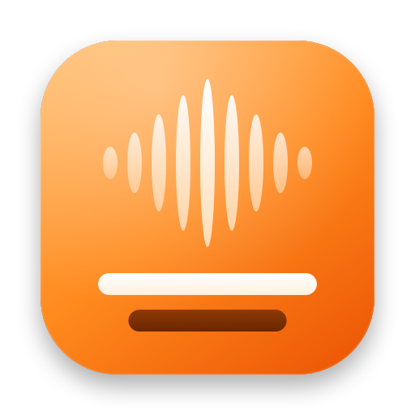

<p align="center"></p>

# MacCaptions

Live **English captions with Chinese (Simplified) translation** for your Mac — for online meetings, videos and your own voice.
It lives in the menu bar, can also show a floating caption window, and can save the transcript and the audio of every session.

Everything runs **on your Mac**: speech recognition and translation use Apple's on-device models, and the app itself makes no network connections.

## Features

- **Two sources at the same time** – system audio (meeting, video, browser…) and the microphone, each recognised separately and labelled *Them* / *Me*. Each source has its own on/off switch, usable at any moment.
- **Live English captions → Simplified Chinese** using Apple's `SpeechAnalyzer` and Translation framework (free, on-device, no account).
- **Menu bar display** with three modes – *English*, *中文* and *Mix* – in a fixed-width item, so the text never jumps around. A panel with the full bilingual transcript opens on click.
- **Floating caption window** (like Windows' *LiveCaptions-Translator*): drag it anywhere, drag its edges to resize, and style it – text colour and size per language, text opacity, background colour / transparency or no background at all, English-only / Chinese-only / both, optional click-through.
- **Record button** – saves each source as AAC audio (separate numbered segments, so you can switch recording on and off mid-session) plus the text.
- **Echo handling** – when the meeting plays through your speakers, the microphone also hears it. The app hides mic lines that just repeat the system audio, and can optionally use Apple's voice processing (slightly lowers other audio).
- **Light on resources** – about 0 % CPU when idle and about 5 % of one core while speech is being transcribed (measured on an M5 Pro).

## Requirements

- **macOS 26.4 or later**
- **Apple silicon** (M1 or newer)
- Chinese and English **translation language packs** (macOS offers to download them; see below)

## Install

1. Download `MacCaptions-<version>-macos-arm64.dmg` from the [Releases](../../releases) page (a `.zip` of the same app is there too).
2. Open the DMG and drag **MacCaptions.app** onto the **Applications** shortcut.
3. The app is **ad-hoc signed, not notarized** (there is no paid Apple developer account behind it), so macOS will warn you the first time. Either:
   - right-click the app → **Open** → **Open**; if there is no Open button, go to *System Settings → Privacy & Security* and click **Open Anyway**, or
   - run once in Terminal: `xattr -dr com.apple.quarantine /Applications/MacCaptions.app`
4. Look for the **MacCaptions** text in your menu bar (the app has no Dock icon). Open it again from Finder to bring up the controls if the menu bar item is hidden.

### First run

- Click the menu bar item → **Start captions**.
- Allow **Microphone** access and, when asked, **System Audio Recording**.
- If asked for translation languages, install **English** and **Chinese (Simplified)**: *System Settings → General → Language & Region → Translation Languages*.
- The first start may download Apple's English speech model.

## Using it

| | |
|---|---|
| **Start / Stop captions** | Begins or ends a session. |
| **Microphone / System audio** | Switch each source on or off at any time. |
| **Record audio** | On by default at every launch; toggle during a session. Text is always saved. |
| **Menu bar text** | English, 中文 or Mix; *Mix: English share* moves the divider; *Menu bar width* up to 1000 pt. |
| **Floating window / Window style…** | Show the caption window and edit its look (also in the window's right-click menu). |
| **Hide mic echo** | Hides mic lines that repeat the system audio (headphones avoid the problem entirely). |

**Saved sessions** go to `~/Documents/LiveCaptions/<date_time>/`:

```
audio/mic_001.m4a, system_001.m4a, …   one file per source per recording stretch (16 kHz mono AAC)
transcript.md                           readable English + Chinese transcript
transcript.jsonl                        one JSON object per sentence (timing, speaker, English, Chinese, flags)
session.json                            session info and where each audio segment starts and ends
```

> Recording a meeting may require the consent of the other participants. Check the rules that apply to you.

## Build from source

Requires Xcode 26.4+ (Swift 6) on Apple silicon.

```bash
git clone https://github.com/chengxuphd/maccaptions.git
cd maccaptions
./make_app.sh            # builds MacCaptions.app (ad-hoc signed) in this folder
open MacCaptions.app
```

Developer tooling (self-tests, a silent audio-file feeder for CPU/memory measurements, screenshot renderers) is compiled only with a flag and is **not** part of the shipped app:

```bash
swift build -Xswiftc -DDEVTOOLS
MACCAPTIONS_SELFTEST=1 .build/debug/MacCaptions      # store / echo-filter self-tests
```

## Known limitations

- English speech → Simplified Chinese only (speech recognition is `en-US`).
- Apple's translation is fluent but weak on idioms and technical terms ("circle back", "agents"); a local-LLM translation engine is a possible future addition.
- Saved audio is 16 kHz mono (what the recogniser hears): fine for review, not for music.
- Only tested on one Mac (Apple silicon, macOS 27); other setups, Bluetooth headsets and device changes mid-session have had little real-world testing.
- Not notarized (see *Install*).

## License

Apache-2.0 — see [LICENSE](LICENSE).
